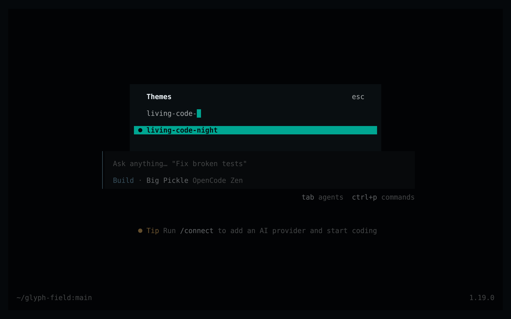
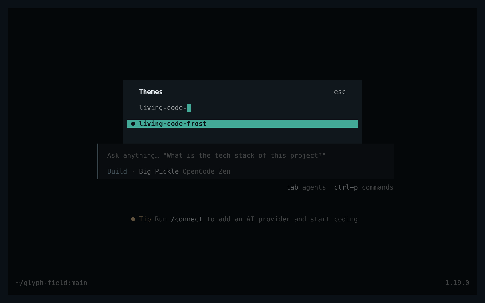
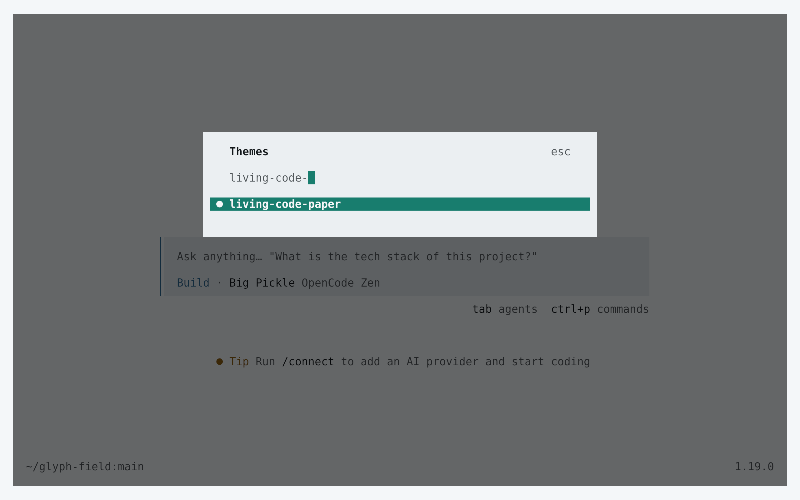
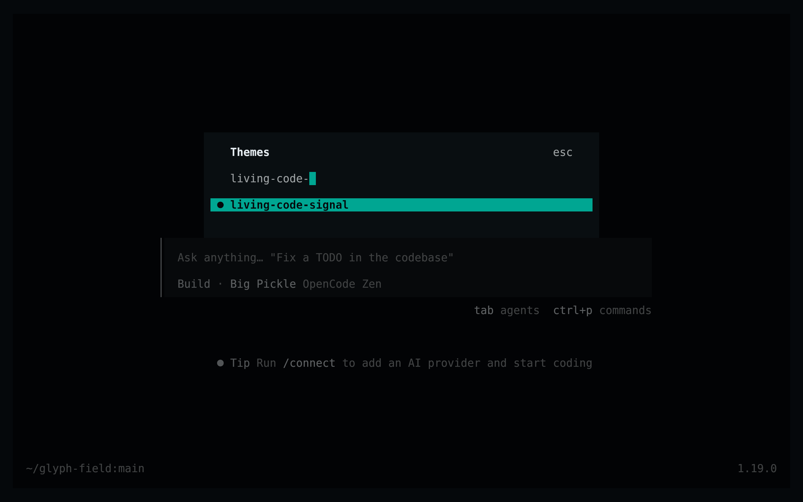

<!-- living-code-readme:1 -->
# 🔓 Living Code for OpenCode

**Calm slate. Living color.** Living Code for OpenCode TUI: complete native JSON palettes for UI, Markdown, syntax highlighting, selections and review diffs.

[Installation](#installation) · [Flavors](#flavors) · [Configuration](#configuration) · [All ports](https://github.com/living-code-theme)

## Previews

<table data-lc-flavors>
<tr>
<td width="50%" valign="top">
<strong>Night</strong><br><sub>Dark · full palette</sub><br><br>
<a href="images/night.png"></a>
</td>
<td width="50%" valign="top">
<strong>Frost</strong><br><sub>Dark · softer chroma</sub><br><br>
<a href="images/frost.png"></a>
</td>
</tr>
<tr>
<td width="50%" valign="top">
<strong>Paper</strong><br><sub>Light · near-white slate</sub><br><br>
<a href="images/paper.png"></a>
</td>
<td width="50%" valign="top">
<strong>Signal</strong><br><sub>Dark · teal accent</sub><br><br>
<a href="images/signal.png"></a>
</td>
</tr>
</table>

Select any preview to view the image at full size.

## Installation

```sh
flavor=night # night, frost, paper, or signal
curl -fsSL --create-dirs -o "${XDG_CONFIG_HOME:-$HOME/.config}/opencode/themes/living-code-$flavor.json" "https://raw.githubusercontent.com/living-code-theme/opencode/main/themes/living-code-$flavor.json"
```

Restart OpenCode, run `/themes` (also available through `/theme` completion), and select `living-code-night` or your downloaded flavor. For a project-only install, use `.opencode/themes/` as the output directory instead.

## Flavors

Expand a flavor for its full-size preview and activation instructions.

<details data-lc-flavor="night">
<summary><strong>Night</strong> · Dark · full palette</summary>

<p><a href="images/night.png"></a></p>

Choose `living-code-night` with `/theme`, or set `"theme": "living-code-night"` in your existing `tui.json`.

</details>

<details data-lc-flavor="frost">
<summary><strong>Frost</strong> · Dark · softer chroma</summary>

<p><a href="images/frost.png"></a></p>

Choose `living-code-frost` with `/theme`, or set `"theme": "living-code-frost"` in your existing `tui.json`.

</details>

<details data-lc-flavor="paper">
<summary><strong>Paper</strong> · Light · near-white slate</summary>

<p><a href="images/paper.png"></a></p>

Choose `living-code-paper` with `/theme`, or set `"theme": "living-code-paper"` in your existing `tui.json`.

</details>

<details data-lc-flavor="signal">
<summary><strong>Signal</strong> · Dark · teal accent</summary>

<p><a href="images/signal.png"></a></p>

Choose `living-code-signal` with `/theme`, or set `"theme": "living-code-signal"` in your existing `tui.json`.

</details>

## Configuration

The files use the OpenCode v1 `{ "theme": { … } }` JSON format. They provide every required color, explicit selected-item text and menu backgrounds. Every flavor is a separate theme, so Paper stays light even in a dark terminal. Put configuration in `tui.json`, not in the theme file; preserve any existing keybindings.

## Compatibility

Targets the TUI theme format verified against OpenCode 1.19.0. This is not the web/desktop theme format. Truecolor gives the intended colors; reduced-color terminals approximate them. OpenCode 2 theme documents are a different API and are not claimed here. Syntax, Markdown and diff color contracts are checked independently of generation.

Previews are captured programmatically from the actual application in an isolated profile. See [`capture/app.py`](capture/app.py) for the app-owned recipe and [`images/capture.json`](images/capture.json) for runtime, palette and image provenance. No mock interface is drawn.

## Contributing

Found a problem? [Open an issue](https://github.com/living-code-theme/opencode/issues/new/choose) with the app version, the flavor and a screenshot. Want Living Code somewhere else? [Request a port](https://github.com/living-code-theme/core/issues/new?template=port-request.yml).

Pull requests are welcome. Keep this README, `port.json` and `images/` in sync, and use real screenshots of the app, never mockups.

🦎 **One chameleon, many habitats.** Part of [Living Code](https://github.com/living-code-theme).

## License

[MIT](LICENSE) © Elliot Luque
